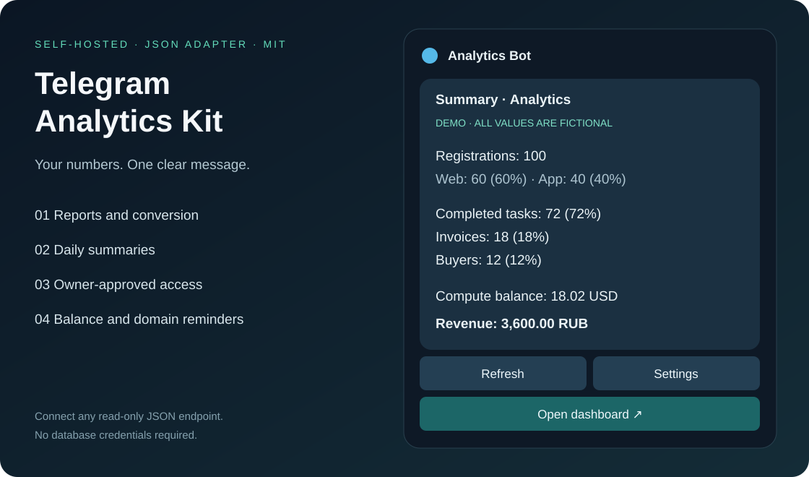

# Telegram Analytics Kit

**Ключевые цифры вашего сервиса — прямо в Telegram.**

Самостоятельный бот для сводок, воронки, оплат, выполненных заданий и остатков
провайдеров. Подключается к вашему JSON API, отправляет ежедневные отчёты и
позволяет выдавать доступ коллегам кнопками в Telegram.



## Возможности

| Что | Как работает |
| --- | --- |
| Короткая сводка | Регистрации, этапы воронки, счета, покупатели, задания, ошибки и выручка |
| Конверсии | Проценты от всех регистраций выбранного UTC-периода, в том числе при фильтре платформы |
| Меню | Сегодня / вчера / 7 дней; платформы настраиваются; обновление одной карточки |
| Ежедневный отчёт | За вчера, в 09:00, 12:00 или 18:00 выбранного часового пояса |
| Доступ | `/start` создаёт заявку, владелец одобряет, отклоняет или отзывает доступ |
| Остатки | Деньги или кредиты из вашего адаптера; USD с двумя знаками и примерным пересчётом в рубли |
| Финансовые напоминания | Владельцам раз в 24 часа, если денег осталось на 5 дней или меньше |
| Продление доменов | Этапы 30 / 7 / 3 / 1 день и истечение, по датам из адаптера |
| Хранение | Redis AOF: доступы, подписки, курсор Telegram и защита от повторных уведомлений |

**Это интерфейс к вашей аналитике.** Бот не собирает события посетителей и не
подключается автоматически к CRM, базе платежей или биллингу провайдеров.
Сначала можно попробовать синтетическое демо, затем реализовать один read-only
endpoint по [контракту](docs/adapter.md). Источник можно написать на любом языке.

## Посмотреть без токена

Нужен Node.js 24+:

```sh
npm ci --ignore-scripts
npm run preview
npm test
npm run smoke
```

`preview` печатает демонстрационную карточку и меню. Все числа вымышлены.
Ни Telegram, ни внешние аккаунты при этом не используются.

## Запуск через Docker

1. Создайте **отдельного бота** в [BotFather](https://t.me/BotFather).
2. Скопируйте `.env.example` в `.env`; заполните `BOT_TOKEN`, `OWNER_IDS` и
   `DASHBOARD_URL`. Секреты остаются на вашем сервере. Не вставляйте их в Git.
3. Выполните:

```sh
docker compose up -d --build
docker compose ps
docker compose logs --tail=30 bot
```

4. Откройте своего бота и отправьте `/start`. Пока `METRICS_MODE=demo`, на каждой
   карточке есть пометка «ДЕМО», служебные финансовые напоминания выключены.
5. Для настоящих цифр переключите `METRICS_MODE=http`, задайте `METRICS_URL` и
   при необходимости `METRICS_BEARER_TOKEN`. Пересоздайте бот:

```sh
docker compose up -d --no-deps --force-recreate bot
```

Redis не публикуется в Интернет. Volume `redis-data` нужно сохранять при
обновлениях и включать в резервное копирование. `docker compose down -v` удалит
подписки, доступы и дедупликацию; для обычной остановки используйте `down` без `-v`.

### Как узнать свой Telegram ID

После заполнения только `BOT_TOKEN` отправьте боту `/whoami` или `/start`.
**Остановите работающий экземпляр** и выполните:

```sh
npm run identity
```

Команда читает кандидатов из личных сообщений, показывает только числовые ID
и ничего не одобряет. Выберите именно свой ID и запишите его в `OWNER_IDS`.
При нескольких кандидатах не выдавайте доступ первому автоматически. Для
работающего бота `/whoami` также доступен без прав просмотра статистики.

## Команды

`/start` · `/today` · `/yesterday` · `/week` · `/settings` · `/access` · `/stop` · `/whoami`

- Первое `/start` одобренного пользователя включает сводку с **завтрашнего** дня.
- `/stop` выключает только его ежедневную сводку. Повторный `/start` не отменяет
  этот выбор. Включить снова можно в «Уведомлениях».
- `/access` доступен только ID из `OWNER_IDS`. Одобренные зрители не могут
  управлять другими людьми и не получают служебные финансовые напоминания.
- Доступ в ваш веб-дашборд настраивается отдельно. Кнопка не обходит его вход.

## Подключение данных

```text
GET https://metrics.example.com/report?start=2026-01-01&end=2026-01-01&platform=all
Authorization: Bearer <ваш read-only токен>
```

Полный формат, пример endpoint и правила расчётов: **[Адаптер данных](docs/adapter.md)**.
Пустой или устаревший ответ не превращается в нулевую выручку. Карточка покажет,
что данные недоступны; автоматические напоминания будут ждать свежего ответа.

## Настройки

| Переменная | Значение по умолчанию |
| --- | --- |
| `BOT_TOKEN`, `OWNER_IDS` | Обязательны для бота, владельцев не больше пяти |
| `REPORT_TITLE` | `Аналитика` |
| `DASHBOARD_URL` | `https://dashboard.example.com`, замените на свой HTTPS URL |
| `TIMEZONE` | `Europe/Moscow`, влияет на доставку и календарные дни до продления |
| `PLATFORMS` | `all:Все,web:Web,app:Приложение`, до шести платформ |
| `METRICS_MODE` | `demo` или `http` |
| `METRICS_URL`, `METRICS_BEARER_TOKEN` | Ваш read-only endpoint и необязательный токен |
| `METRICS_MAX_AGE_SECONDS` | `900`, допустимый возраст снимка |
| `USD_RUB_RATE` | `85`, явно примерный фиксированный курс |
| `LOW_BALANCE_DAYS` | `5`, прогноз из адаптера, без деления баланса на выдуманный тариф |
| `FINANCE_REMINDERS_ENABLED` | `true`, но в demo всегда выключено |
| `REDIS_URL` | `redis://localhost:6379`; Compose задаёт свой внутренний адрес |
| `TELEGRAM_CONNECT_IPV4` | Пусто; необязательный маршрут к `api.telegram.org`, TLS сохраняется |
| `HEALTH_PORT` | `3000`, в Compose наружу не публикуется |

Суммы и события считаются по **UTC**, как указано в контракте. Часовой пояс
доставки не меняет границы отчёта. Остатки провайдеров и сроки доменов — текущие
данные всего аккаунта, а не расход только за выбранные даты или платформу.

## Проверки

```sh
npm run check
npm test
npm run smoke
npm run integration   # нужен отдельный Redis, см. REDIS_URL
npm audit --omit=dev
docker build -t analytics-kit .
```

CI выполняет те же проверки с настоящим Redis и собирает Docker-образ.
`GET /health` возвращает 200 только после успешного свежего Telegram polling;
проверка подключения источника данных отражается отдельно в карточках/логах.

Практические ограничения: [эксплуатация](docs/operations.md),
[безопасность](SECURITY.md), [участие в разработке](CONTRIBUTING.md).

## Лицензия

[MIT](LICENSE) — можно использовать, адаптировать и разворачивать у себя.
